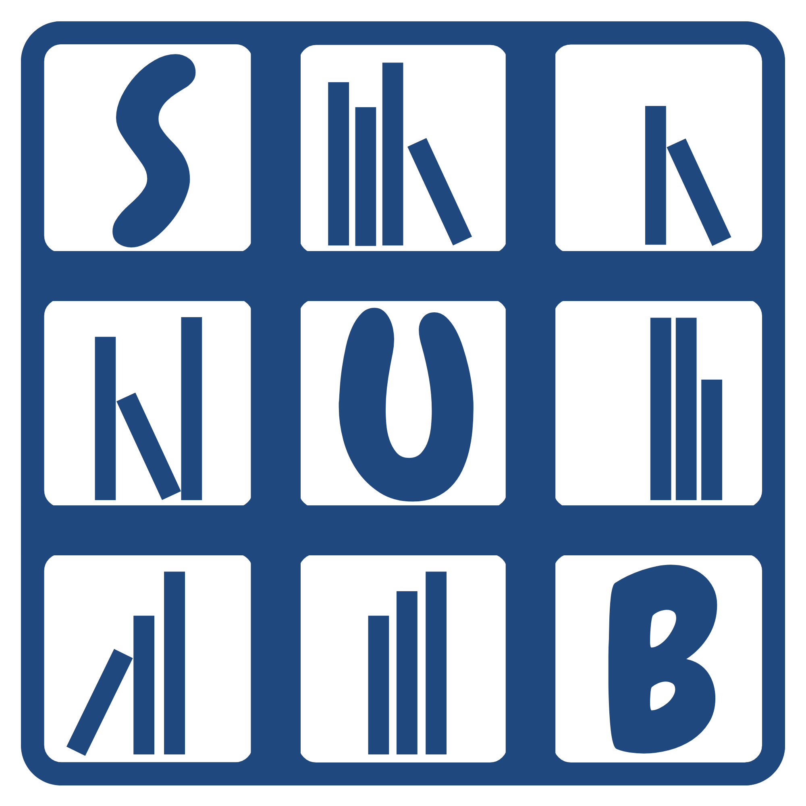
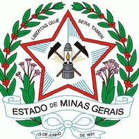

  

  <h1>SUB</h1>
  
<strong>Sistema Único Bibliotecário</strong>

  
Registro público da minha participação no desenvolvimento do sistema.

  
  

---

> [!IMPORTANT]
> **Registro institucional**
>
> Este repositório possui caráter exclusivamente informacional e histórico. O SUB é um sistema de propriedade do Estado de Minas Gerais, sob responsabilidade institucional da Secretaria de Estado de Educação de Minas Gerais (SEE/MG).
>
> O código-fonte, a documentação interna e os dados operacionais não são disponibilizados publicamente. Este repositório não representa o ambiente oficial de desenvolvimento do sistema.

## O SUB

O SUB é a refatoração do sistema de gestão desenvolvido para a Biblioteca Gastão Valle. Após a apresentação do projeto original ao Governo de Minas Gerais, a equipe foi convidada a desenvolver uma nova versão para atender toda a rede estadual de ensino.

## Minha participação

Participo do desenvolvimento e da evolução contínua do SUB em um trabalho colaborativo. Este repositório preserva essa trajetória de forma pública e objetiva, sem expor conteúdos internos do projeto.

## Registro

<table>
  <tr>
    <td width="64" align="center"><strong>01</strong></td>
    <td>
      <strong>Origem</strong> 
      Participei do desenvolvimento do sistema que deu início a essa trajetória na Biblioteca Gastão Valle.
    </td>
  </tr>
  <tr>
    <td width="64" align="center"><strong>02</strong></td>
    <td>
      <strong>Reconhecimento</strong> 
      O projeto original foi reconhecido e divulgado pelo Governo de Minas Gerais.
    </td>
  </tr>
  <tr>
    <td width="64" align="center"><strong>03</strong></td>
    <td>
      <strong>Continuidade</strong> 
      Hoje participo da evolução do SUB para a rede estadual de ensino.
    </td>
  </tr>
</table>

## Contexto técnico

O SUB é uma aplicação desktop desenvolvida em C# e .NET Framework, com Windows Forms e armazenamento local. As tecnologias acima descrevem o contexto do sistema, não uma atribuição individual de responsabilidades.

## Reconhecimento institucional

<table>
  <tr>
    <td align="center" width="152">
      
    </td>
    <td>
      <strong>Secretaria de Estado de Educação de Minas Gerais</strong> 
      O sistema original foi reconhecido e divulgado oficialmente pelo Governo de Minas Gerais.  
      <a href="https://www.agenciaminas.mg.gov.br/noticia/estudantes-de-escola-estadual-desenvolvem-sistema-para-modernizar-biblioteca"><strong>Matéria oficial ↗</strong></a>
      &nbsp;·&nbsp;
      <a href="https://www.gastaovalle.com/pages/equipe-dev.html">Equipe do projeto</a>
    </td>
  </tr>
</table>

  Histórico de contribuições registrado desde 2025.

